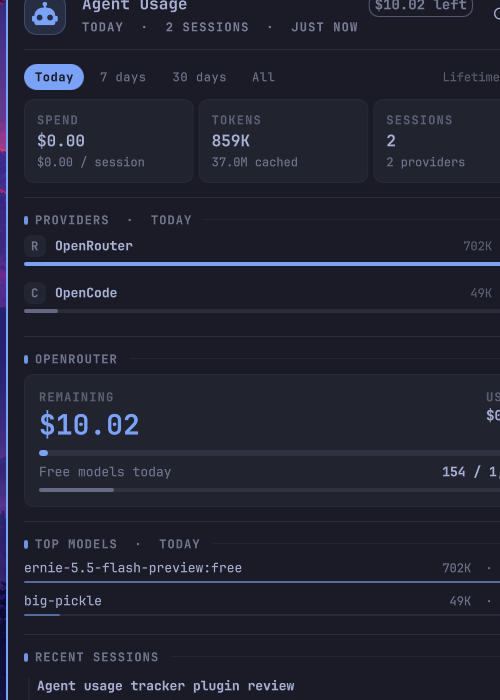
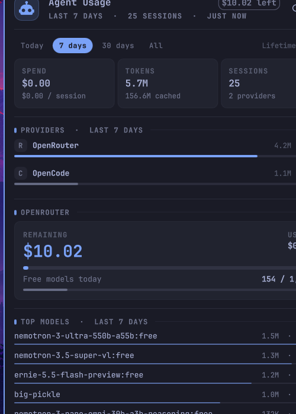
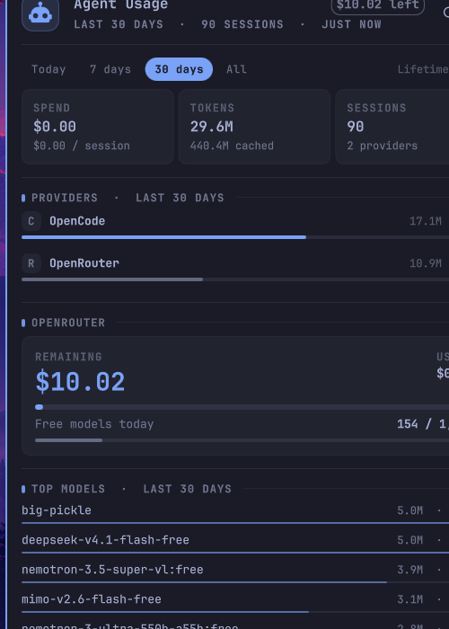
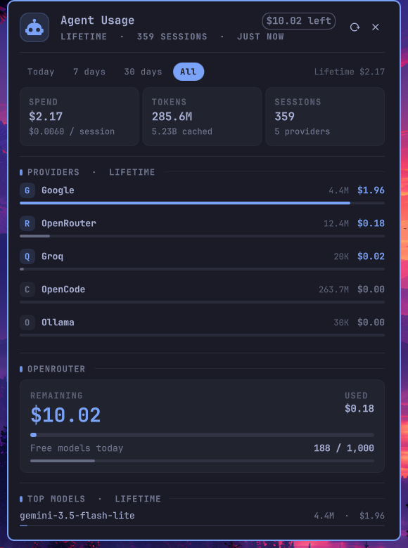

| Today | Last 7 days |
| :---: | :---: |
|  |  |

| Last 30 days | Lifetime |
| :---: | :---: |
|  |  |

# Agent Usage Tracker

A premium bar panel for [Omarchy](https://omarchy.org/) that shows token usage
and spend across OpenCode and OpenRouter — today, 7 days, 30 days and lifetime —
with per-provider and per-model breakdowns, recent sessions and live OpenRouter
credits.

## Features

- **One panel, four windows** — Today / 7 days / 30 days / Lifetime, switchable
  from the chips or keys `1`–`4`.
- **Accurate attribution** — cost and tokens are read per reply from OpenCode's
  message stores and charged to the model and provider that actually served it,
  so switching models mid-session does not move spend onto the last model.
- **Providers at a glance** — per-window provider rows with logo badges, token
  counts, cost and share bars.
- **Top models** — the busiest models in the selected window, with usage bars.
- **Recent sessions** — the last conversations, with model, tokens, cost and
  age. Subagent sessions are excluded so the list stays readable.
- **OpenRouter credits** — remaining/used credits, free-model allowance, key
  usage and budget in one card, with a low-credit warning.
- **Theme-aware** — built from Omarchy's shell UI kit; follows the active theme,
  light or dark.

## Requirements

- Omarchy 4.x
- Python 3 (standard library only)
- OpenCode (the local `opencode.db` is read read-only)

## Install

```bash
omarchy plugin add https://github.com/Davedes83/agent-usage-tracker --enable
omarchy bar put davedes.agent-usage-tracker --section right
```

`omarchy plugin add` clones the repo into `~/.config/omarchy/plugins/` and
enables it. To place it yourself later:

```bash
omarchy bar move davedes.agent-usage-tracker --section right
```

### OpenRouter (optional)

Credits and free-model usage need an API key. Put it in
`~/.config/environment.d/openrouter.conf`:

```bash
OPENROUTER_API_KEY=sk-or-v1-...
```

or export `OPENROUTER_API_KEY` in your environment. The key is only used for
`GET /api/v1/auth/key` and `GET /api/v1/credits`; it is never written to the
cache or logs. Without a key the panel still shows local OpenCode usage.

## Usage

- Click the bar icon to open the panel; click again or press `Esc` to close.
- `1` `2` `3` `4` switch the window, `R` refreshes, `Tab` cycles panels.
- Right-click or middle-click the bar icon refreshes.
- IPC: `omarchy-shell davedes.agent-usage-tracker refresh|open|close|toggle`

## How it works

`scripts/usage.py` runs on each refresh (default every 30 s) and prints one JSON
document on stdout:

- reads `~/.local/share/opencode/opencode.db` **read-only** (`mode=ro`);
- aggregates assistant/compaction replies from `session_message` (v2) and
  `message` (v1), deduplicated by message id, skipping fork copies;
- excludes subagent sessions (`parent_id`) from session counts and recent rows;
- caches the OpenRouter response for 90 s to stay under the API rate limit.

The QML panel (`Panel.qml`) is a passive renderer; `BarWidget.qml` owns the
collector process and IPC.

## Development

```bash
cd ~/.config/omarchy/plugins/davedes.agent-usage-tracker
python3 scripts/usage.py | python3 -m json.tool   # inspect collector output
omarchy plugin validate .                          # manifest check
qmllint -I /usr/lib/qt6/qml -I /usr/share/omarchy/shell Panel.qml
omarchy-shell davedes.agent-usage-tracker refresh  # reload data
```

## License

MIT — see [LICENSE](LICENSE).